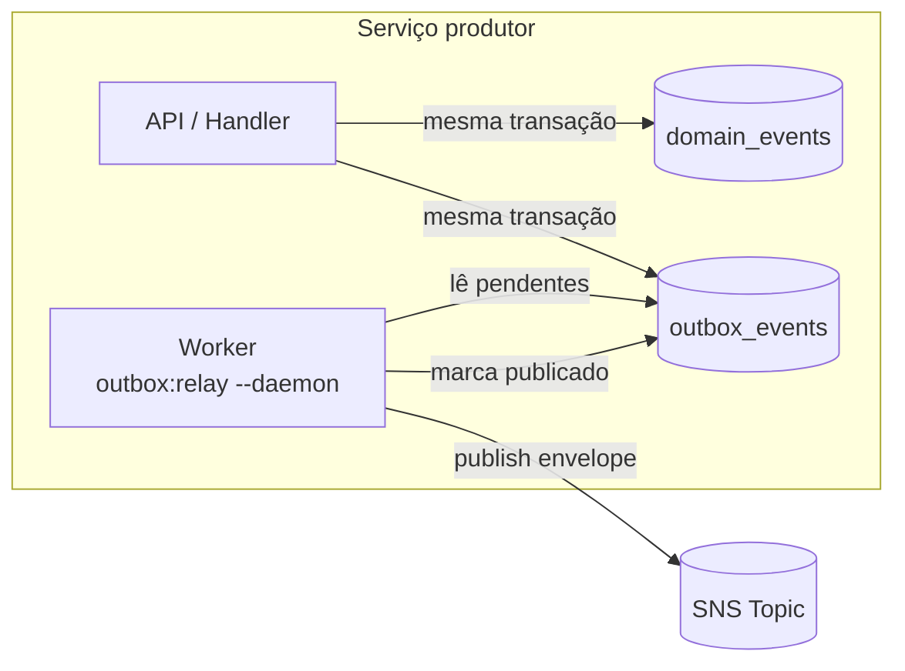
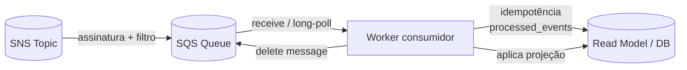
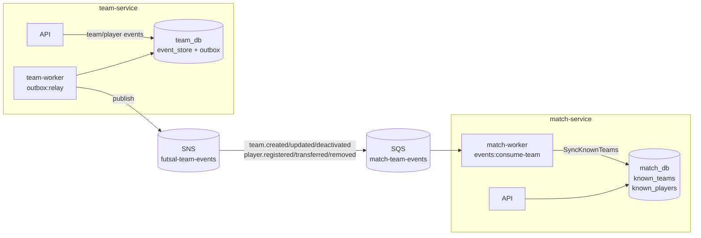
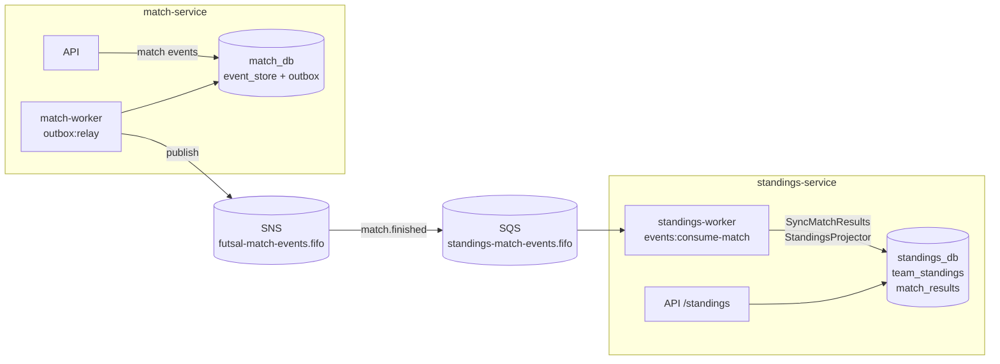

# Futsal API

Monorepo event-sourced com BFF fino e três serviços de domínio.

## Arquitetura

- `bff/`: autenticação Passport, rotas públicas e agregação de leitura (somente API).
- `team-service/`: times e jogadores (event store + projeção) + `team-worker` de outbox.
- `match-service/`: partidas e regras de jogo + `match-worker` de outbox e consumo de times.
- `standings-service/`: classificação como projeção somente leitura + `standings-worker` de consumo de partidas.
- `packages/contracts/`: envelope de eventos e assinatura interna.
- `packages/event-sourcing/`: agregados, event store, outbox e consumo SQS.

Cada serviço de domínio usa a mesma imagem para dois containers:

- **API**: expõe HTTP e roda migrations.
- **Worker**: não expõe porta; roda apenas comandos de outbox/consumo de fila.

Fluxo de escrita:

1. BFF valida o token e assina a chamada interna.
2. Serviço de domínio valida a assinatura, carrega o agregado, grava eventos e outbox na mesma transação.
3. Worker de outbox publica no SNS.
4. SNS entrega no SQS.
5. `standings-worker` consome `match.finished` e atualiza `team_standings`.

## Diagramas

### Comunicação entre serviços

```mermaid
flowchart LR
    subgraph Clientes
        C[Cliente]
    end

    subgraph Borda
        BFF[BFF\nPassport\n:8000]
    end

    subgraph Dominio[Serviços de domínio]
        T[team-service\nAPI :8001]
        M[match-service\nAPI :8002]
        S[standings-service\nAPI :8003]
    end

    subgraph Dados[(Bancos)]
        BDB[(bff_db)]
        TDB[(team_db)]
        MDB[(match_db)]
        SDB[(standings_db)]
    end

    C -->|HTTP + JWT| BFF
    BFF --> BDB
    BFF -->|HTTP interno assinado HMAC| T
    BFF -->|HTTP interno assinado HMAC| M
    BFF -->|HTTP interno assinado HMAC| S

    T --> TDB
    M --> MDB
    S --> SDB
```

### Publicação de eventos (Transactional Outbox → SNS)



### Consumo de eventos (SNS → SQS → Worker → Projeção)



### Cadeia: Team → Match (sincronização de times/jogadores)



### Cadeia: Match → Standings (classificação)



## Requisitos

- Docker e Docker Compose
- PHP 8.5 e Composer (para rodar testes fora do container)

## Subir a stack

```bash
docker compose up -d --build
```

Serviços:

- BFF: `http://localhost:8000`
- team-service: `http://localhost:8001`
- match-service: `http://localhost:8002`
- standings-service: `http://localhost:8003`
- LocalStack: `http://localhost:4566`

Workers `team-worker`, `match-worker` e `standings-worker` não expõem portas.

## Bancos

`bff_db`, `team_db`, `match_db`, `standings_db`, `futsal_test_db` no PostgreSQL local.

## Endpoints públicos

- `POST /api/login`, `POST /api/logout`, `POST /api/user`
- `GET/POST /api/teams`, `GET/PUT/DELETE /api/teams/{id}`
- `POST /api/teams/{teamId}/players`, `PUT/DELETE /api/players/{id}`
- `GET/POST /api/matches`, `GET /api/matches/{id}`
- `POST /api/matches/{id}/start`, `/goals`, `/finish`, `/cancel`
- `GET /api/standings`
- Aliases somente leitura: `/api/team`, `/api/teamMatch`, `/api/teamClassification`

## Testes

```bash
docker compose exec bff php artisan test
docker compose exec team-service php artisan test
docker compose exec match-service php artisan test
docker compose exec standings-service php artisan test
```

E2E:

```bash
./tests/e2e/full-flow.sh
```

## Operação

- Containers de worker (sem porta HTTP):
  - `team-worker`: `php artisan outbox:relay --daemon`.
  - `match-worker`: `outbox:relay --daemon` + `events:consume-team`.
  - `standings-worker`: `events:consume-match`.
- Reprojeção: `php artisan standings:rebuild`.
